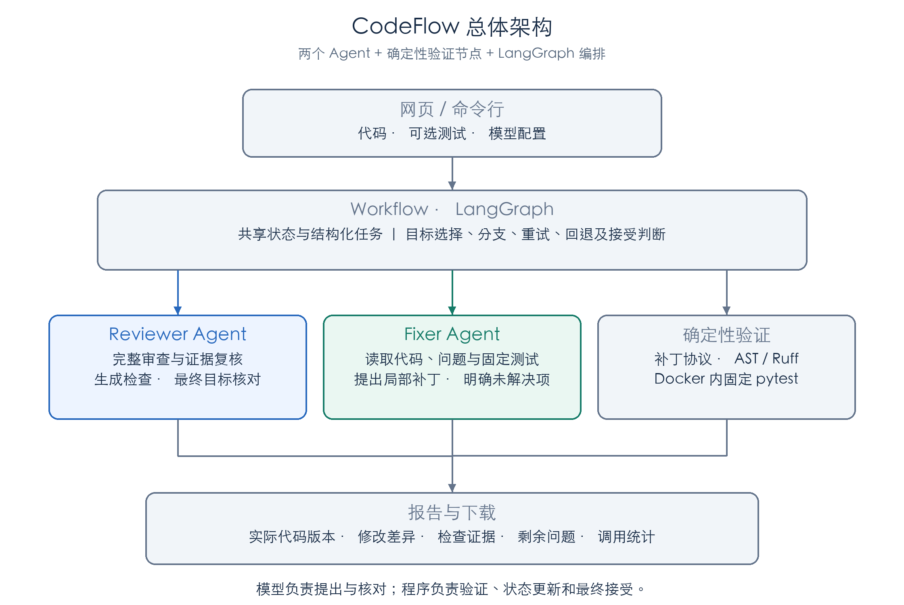
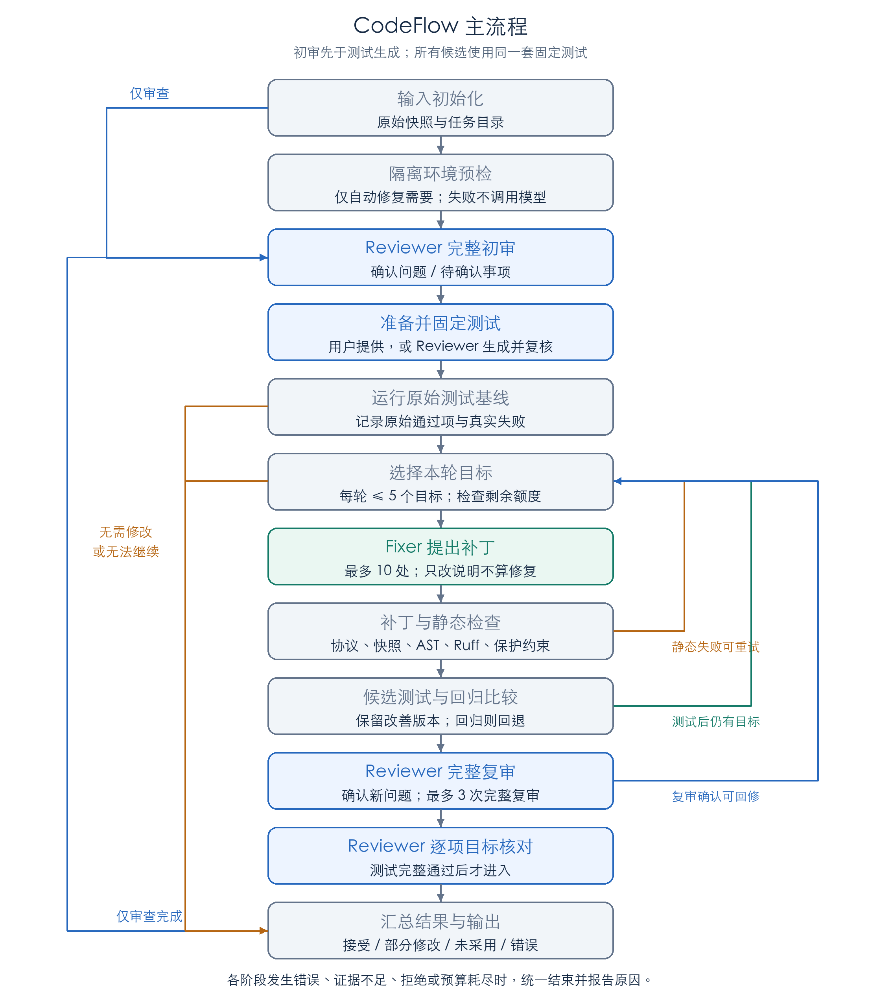
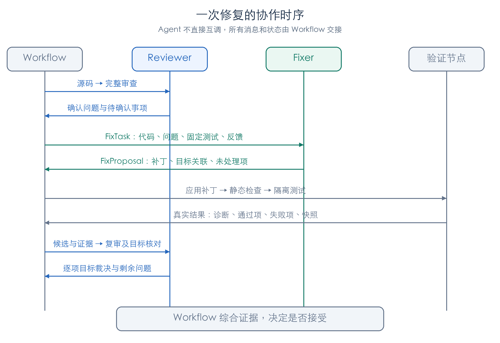
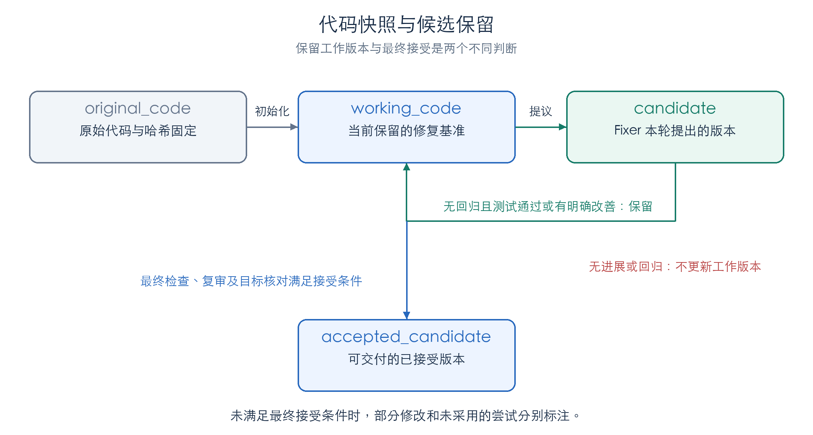

# CodeFlow 设计文档

> 双 Agent 代码审查与修复 Workflow

## 1. 设计目标

用户提交一个 Python 文件，系统完成代码审查、局部修复、隔离测试、复审与结果导出。用户可以只审查，也可以自动修复；不要求填写功能描述。

**设计核心：Reviewer 负责发现和核对问题，Fixer 负责修改代码，确定性程序负责验证，LangGraph 负责组织流程并决定是否接受结果。** 两个 Agent 通过共享状态和结构化任务协作，不直接互相调用。

| 作业要求            | 实现方式                                                                |
| ------------------- | ----------------------------------------------------------------------- |
| 至少两个 Agent 协作 | Reviewer 审查和复核；Fixer 根据确认问题生成补丁                         |
| 消息传递或状态共享  | `WorkflowState` 共享状态，`FixTask`、`FixProposal` 等作为交接协议 |
| 顺序与条件控制      | LangGraph 串联节点，根据模式、检查结果和预算路由                        |
| 循环与错误恢复      | 有限重试、候选回退、重复检测、明确停止原因                              |
| 日志与状态追踪      | 节点事件、每轮证据、模型调用统计和综合报告                              |

项目范围为单个业务模块、单个测试文件，支持标准库和固定 pytest 环境。不处理整个仓库、多模块依赖、任意依赖安装和用户 pytest 插件。

## 2. 总体架构



*图1：界面提交输入，Workflow 组织两个 Agent 与验证模块，报告层输出实际结果。蓝色为 Reviewer，绿色为 Fixer，灰色为确定性程序。*

| 层次         | 主要模块                                                           | 职责                                                  |
| ------------ | ------------------------------------------------------------------ | ----------------------------------------------------- |
| 入口层       | `app.py`、`cli.py`                                             | 输入、模型配置、执行入口、进度与下载                  |
| 编排层       | `workflow/graph.py`、`state.py`、`routing.py`                | 共享状态、目标选择、条件分支、预算和接受判断          |
| Agent 层     | `agents/reviewer.py`、`agents/fixer.py`                        | 审查、生成检查、提出修改、目标核对                    |
| 验证层       | `validation/patch_checks.py`、`test_runner.py`、`sandbox.py` | 补丁检查、真实 pytest、容器隔离                       |
| 协议与报告层 | `schemas.py`、`reporting.py`                                   | Pydantic 校验、快照关联、结果和过程记录               |
| 基础能力     | `review_agent/`                                                  | 复用作业一的完整审查、AST、Ruff、取证工具和模型适配器 |

### 2.1 为什么这样划分

- **职责分离**：发现问题、提出修复、验证结果分别承担，避免 Fixer 自己宣布成功。
- **模型与程序分工**：模型判断语义和修复方案；程序决定补丁是否合法、测试是否通过及流程能否继续。
- **双层图结构**：外层 LangGraph 管理审查与修复；Reviewer 内部保留原审查图的取证、证据核验和独立复核。
- **独立提交**：`review_agent/` 随项目提供，不跨目录导入作业一，也不依赖作业一的虚拟环境。

这里的两个 Agent 是两个职责和协议不同的角色，可以调用同一个模型服务；pytest 执行器是普通程序节点，不计作第三个 Agent。

## 3. 输入、输出与使用模式

| 输入         | 规则                                                                |
| ------------ | ------------------------------------------------------------------- |
| Python 源码  | 必填；UTF-8；最多 2000 行、102400 字节；允许语法错误进入审查        |
| pytest 测试  | 自动修复时可选；通过 `import solution` 引用源码；有测试时固定使用 |
| 额外行为约定 | CLI 可选，最多 1000 字；网页无需填写                                |
| 模型配置     | API Key、服务地址、模型 ID；网页侧栏或 CLI 环境变量配置             |

输入先检查原始字节和编码，再统一换行为 LF，拒绝空白、NUL 和超限内容。测试必须语法有效，不允许 Fixer 修测试。

| 模式     | 执行内容                                         | Docker   |
| -------- | ------------------------------------------------ | -------- |
| 仅审查   | 完整审查并输出问题，不调用 Fixer、不运行输入代码 | 不需要   |
| 自动修复 | 预检、审查、固定测试、有限修复、复审和目标核对   | 必须可用 |

未提供测试时，Reviewer 依据原代码、确认问题和可证实约定生成检查。系统记录 `tests_origin=user/generated/none`；生成测试在基线前固定，此后不得根据候选结果改写。

**用户测试可表达明确行为约定；模型生成的测试不能单独授权未知业务规则。** 例如，一般除法函数抛出 `ZeroDivisionError` 并不必然是缺陷；是否需要改变异常类型，应由用户测试或其他明确依据决定。

## 4. Workflow 与流程控制



*图2：主路径与修复回路。每个阶段都可以因环境、协议、证据或预算不足结束；结束时统一生成报告。*

### 4.1 节点职责

| 节点               | 输入与处理                                       | 输出或下一步                                       |
| ------------------ | ------------------------------------------------ | -------------------------------------------------- |
| `initialize`     | 规范化输入，建立原始快照和任务目录               | 仅审查进入初审；自动修复进入预检                   |
| `preflight`      | 真实运行最小容器测试，核对隔离配置               | 成功进入初审；失败停止且不调用模型                 |
| `initial_review` | 完整审查源码，区分确认问题与待确认事项           | 仅审查结束；自动模式准备固定测试                   |
| `generate_tests` | 无用户测试时生成草稿并复核或修正                 | 保存测试及哈希，进入基线                           |
| `baseline`       | 对原始源码运行固定测试                           | 记录原始通过集合及失败证据                         |
| `select`         | 优先选未处理的确认审查问题，再选有依据的测试失败 | 每轮最多 5 个目标；无目标或额度不足则结束或复审    |
| `fixer`          | 提交局部补丁或说明无法确定的修法                 | 合法提议进入静态检查；拒绝或协议错误停止           |
| `static`         | 应用补丁并执行协议、AST、Ruff 和保护检查         | 通过后测试；可恢复失败则反馈并重试                 |
| `tests`          | 对候选运行同一套测试并比较回归与进展             | 保留或回退候选；选择下一轮或进入复审               |
| `final_review`   | 完整审查当前工作版本                             | 有确认问题且额度充足则回修；测试完整通过才进入核对 |
| `assessment`     | Reviewer 逐项核对已保留修改的目标                | 程序综合证据决定是否接受                           |
| `finish`         | 汇总代码、问题、过程、调用和停止原因             | 输出 `WorkflowReport`                            |

### 4.2 重试与停止

默认最多 **8 轮修复、3 次完整复审**；一次 Fixer 提议及后续验证算一轮，失败也消耗额度。每次完整审查最多 8 次逻辑模型调用。

可恢复的补丁或代码检查失败进入下一轮；重复候选、Fixer 拒绝猜测、模型请求失败、协议错误、环境异常或预算耗尽提前停止。环境缺失不会静默降级成仅审查。

测试完整通过后，如果仍有明确目标和轮数，继续修复；否则复审。复审确认问题在修复与复审额度均有剩余时可返回修复。目标核对不再新增修复循环。

若停止时保留了部分修改、但未完成当前版本复审，`finish` 在剩余复审预算内补做一次诊断审查；它不能把测试未通过的代码提升为成功结果。

## 5. 两个 Agent 如何协作



*图3：以一次候选获保留的修复为例。消息通过 Workflow 中转；测试失败时，实际失败证据随下一轮任务返回 Fixer。*

### 5.1 Reviewer：发现问题与核对修复

| 接口                                                      | 职责与约束                                                                              |
| --------------------------------------------------------- | --------------------------------------------------------------------------------------- |
| `review(code, filename, requirement)`                   | 调用完整 `ReviewAgent.review()`；执行静态分析、模型分析、只读取证、证据定位与独立复核 |
| `generate_tests(code, requirement, review)`             | 未提供测试时生成检查；最多两次调用，用于草稿及一致性复核，或修正无效草稿；不执行代码    |
| `assess_fix(context, candidate, static, tests, review)` | 最多一次调用，无工具；逐目标返回 `resolved/unresolved/uncertain`                      |

只有 `static_confirmed`、`model_reviewed` 问题可进入自动目标；`needs_confirmation` 保留人工处理。严重程度与确认程度是两个字段，不能把“高风险但待确认”当成自动修改授权。

完整审查未提供额外约定时沿用原默认审查重点；有约定时传入完整审查和独立复核。工具失败或证据覆盖不足必须记录限制，不能解释成“没有问题”。

### 5.2 Fixer：根据证据修改可执行代码

接口为 `propose(task: FixTask) -> FixProposal`。任务包含：

| 信息                           | 用途                                                       |
| ------------------------------ | ---------------------------------------------------------- |
| 当前源码、源码哈希和带行号视图 | 第一轮是原始代码，后续是最新保留版本；补丁必须对应当前快照 |
| 审查报告、目标与关联证据       | 明确“哪里有问题、触发条件是什么、这轮要解决什么”         |
| 固定测试全文、测试来源及哈希   | 查看实际断言；区分用户约定与模型生成的检查                 |
| 可选行为约定和待确认事项       | 约束修法，保护不能擅自改写的部分                           |
| 最近两轮反馈                   | 获取失败候选、静态错误、测试结果及是否已回退               |

模型返回局部补丁：`line_start/line_end/original/replacement/rationale`，并用 `patch_targets` 关联目标；每轮最多 10 处。没有处理的目标写入 `unaddressed`，必要业务选择无法确定时返回 `cannot_fix` 及原因。

每轮最多两次模型调用：首次可直接提交或请求最多 5 个只读取证工具，第二次必须提交。首次格式、任务标识错误或只改注释时，可利用第二次纠正，不额外增加免费调用。

**Fixer 必须修改缺陷对应的可执行逻辑。** 只增加注释、文档或调整格式不能算缺陷修复。程序在 Fixer 返回前和静态节点分别检查；该检查比较移除文档字符串后的 AST，只能排除这些无效修改，不能单独证明语义正确。

Fixer 不执行上传代码，不修改测试、要求、环境或检查规则，也不直接调用 Reviewer。它提出方案，是否保留由 Workflow 判断。

### 5.3 自主生成与固定规则的边界

- 正常网页和 CLI 使用 `DeepSeekModel` 请求真实服务；补丁来自模型响应，没有按样例名称选择预写补丁的分支。
- AST/Ruff 使用固定规则提供诊断，例如字面量除零；这是静态检查能力，不是预置修复答案。变量分母的处理仍需要上下文和行为依据。
- `tests/` 中的 `ScriptedModel` 提供可控输出，验证错误、预算和分支；它不证明在线模型能够自主发现和修复同类问题。

## 6. 状态模型与交接协议



*图4：原始代码保持不变；候选检查失败时工作版本不变；候选获保留后才成为下一轮基准。最终接受是独立步骤。*

### 6.1 核心协议

| 数据结构           | 关键字段                                                                            | 作用                           |
| ------------------ | ----------------------------------------------------------------------------------- | ------------------------------ |
| `FixTask`        | task_id、source/hash、goals、targets、tests/origin/hash、reference_review、feedback | 向 Fixer 交付可核对的修复任务  |
| `FixProposal`    | decision、patches、patch_targets、unaddressed、missing_information                  | 记录修改方案或拒绝原因         |
| `StaticResult`   | candidate_code/hash、diff、diagnostics、errors、status                              | 保存补丁应用及静态证据         |
| `TestResult`     | source/tests_hash、collected、passed/failed、phases、failures、complete             | 保存真实执行结果               |
| `FixAssessment`  | run_id、candidate_hash、task_id/goal_id、verdict、reason                            | 保证最终逐项核对，无遗漏或重复 |
| `Attempt`        | task、proposal、static、tests、retained、regression、next_source_hash               | 追踪一轮修改及保留理由         |
| `WorkflowReport` | status、各阶段证据、accepted/partial_candidate、剩余问题、调用统计                  | 对外统一结果                   |

Pydantic 约束字段、长度、枚举及关联关系，拒绝额外字段；源码、要求、测试内容与 SHA-256 必须一致。哈希用于关联快照，不代表正确性证明。

### 6.2 状态更新规则

`original_code/hash` 在运行内固定；`working_code/hash` 仅随获保留的候选更新；`candidate` 表示一次尝试；`accepted_candidate` 只能由最终接受节点设置。目标的“已尝试处理”不等于“已解决”。

旧报告行号只属于 `review_source_hash`。源码变化后重新定位证据；补丁原文在当前快照唯一且完全一致时才校正行号，歧义拒绝。反馈同时标明被测候选与当前工作快照，避免回退后错用失败版本的行号。

## 7. 确定性验证与接受规则

### 7.1 补丁与静态检查

1. 核对任务、源码哈希、目标及补丁关联；原文必须匹配，范围不能越界或重叠。
2. 应用局部替换；禁止整文件重写、超限、删除有效函数或类、添加检查抑制配置。
3. 检查可执行 AST 是否变化，并重新运行 AST/Ruff。
4. 按来源、规则、证据、位置映射和诊断数量做一对一比较；指定静态目标仍存在、新增诊断或无法可靠匹配时不放行。
5. 保护待确认事项的原始证据；冲突目标可整组暂缓，其他独立修改继续检查。文本保护不等于语义完全不受影响。

### 7.2 基线、回归与工作候选

设原始通过集合为 `P₀`，当前工作版本通过集合为 `Pｗ`，候选通过集合为 `Pｃ`。保护条件为：

```text
P₀ ∪ Pｗ ⊆ Pｃ
```

| 候选情况                                     | 处理                             |
| -------------------------------------------- | -------------------------------- |
| 所有测试完整通过，无保护项回归               | 保留候选，继续剩余目标或进入复审 |
| 无回归，且至少一个当前失败项变通过           | 保留为部分改善的工作版本         |
| 原通过项失败                                 | 回退候选，反馈回归项             |
| 没有明确改善                                 | 工作版本不变，反馈后在额度内重试 |
| 测试身份改变、跳过、报告不足、超时或环境失败 | 停止，不判成功                   |

基线与所有候选使用同一测试哈希、同一测试身份；原代码语法错误导致无法收集是明确例外，修复后仍须完整执行。

完整调用阶段存在未归因失败时，仅在初审已有确认目标的前提下允许针对这些目标修复、比较进展；不能把未知失败改写成已确认问题。新增未归因错误类型或位置会停止，原通过项回归始终拒绝。未解决的失败不能进入最终接受。

### 7.3 最终接受

候选须同时满足：静态检查通过、固定测试完整通过、全部纳入修改的目标获 `resolved`、最终完整审查覆盖有效且无新增确认问题，快照关联一致。

“完整通过”要求测试非空、所有收集项的 setup/call/teardown 均通过、无 skip/xfail、退出码为 0、报告和日志未截断。目标裁决的 ID 必须完整唯一；模型无法改写 `TestResult`。

| 最终状态             | 含义                                                           |
| -------------------- | -------------------------------------------------------------- |
| `verified`         | 候选获接受，且无剩余确认问题或人工事项                         |
| `no_repair_needed` | 原始测试与完整初审均通过，无需调用 Fixer                       |
| `needs_attention`  | 仍有未解决问题、待确认事项或验证不足；可能包含已接受的局部修复 |
| `error`            | 环境、请求、协议等错误阻止流程                                 |
| `review_completed` | 仅审查完成，不表示运行过测试或修复成功                         |

输出严格区分：`accepted_solution.py` 为已接受版本；`partial_solution.py` 为实际保留但未完成最终核验的版本；`last_attempt_solution.py` 为未被采用的最后尝试。文件名不是状态的唯一依据，报告同时记录接受条件与剩余问题。

## 8. 执行隔离、异常与预算

### 8.1 隔离测试

业务源码和测试只在容器中执行，不在宿主机导入执行；环境不可用时停止。镜像固定 Python 3.12.8、pytest 8.3.5 及依赖，构建时可联网，任务时使用已核对的镜像 ID，不临时拉取或安装依赖。

| 边界       | 设置                                                                         |
| ---------- | ---------------------------------------------------------------------------- |
| 权限       | 非 root UID/GID 65532、只读根目录、全部 capabilities 移除、no-new-privileges |
| 网络与输入 | 无网络；仅只读挂载本次源码与测试，不挂载主目录、Docker socket 或凭证         |
| 资源       | 1 CPU、512 MiB 内存、64 进程、64 MiB 临时空间；默认 15 秒                    |
| 报告与清理 | stdout/stderr 各限 64 KiB，机器报告限 2 MiB；超时终止，结束清理整个容器      |

预检同时核对 Docker 配置及容器内的真实限制。pytest 采集器记录测试身份、阶段、异常和耗时；报告缺失、截断或容器清理失败均限制结论。该边界保护宿主环境，不能保证同解释器中的恶意代码完全无法干扰采集器。

### 8.2 异常与调用预算

节点统一记录开始、完成、失败事件；错误保留已获得的证据和停止原因。API Key 不进入共享状态、报告、日志和容器；模型错误使用异常类型及 HTTP 状态生成提示，不保存可能含凭证的异常正文。

| 项目           |                                     上限 |
| -------------- | ---------------------------------------: |
| 单次完整审查   |                         8 次逻辑模型调用 |
| 单轮 Fixer     |          2 次调用、最多 5 个只读取证工具 |
| 修复轮数       |                             1–8，默认 8 |
| 完整复审       |             最多 `min(3, 修复轮数)` 次 |
| 测试生成及复核 |                            最多 2 次调用 |
| 最终目标核对   |                            最多 1 次调用 |
| 自动模式总预算 | `9 + 8 × min(3,n) + 2n + 2g`，最大 51 |

`n` 为配置轮数，生成测试时 `g=1`，否则 `g=0`。仅审查预算为 8。失败调用也扣额度；HTTP 重试与逻辑调用分别统计，普通请求超时 40 秒、最多两次 HTTP 重试。Token 未返回时记录 `null`。

## 9. 网页交互、报告与文件生命周期

网页采用工作线程运行 Workflow，通过 Queue 向 UI 线程传递事件，每 0.5 秒刷新进度。线程不直接渲染页面；单会话不同时启动两个任务。输入或配置改变后旧结果标记过期，新任务先清空旧展示，避免失败时误显示上次成功。

结果页包括初审问题、代码、修改过程、修改后情况、结束原因和模型调用记录。代码与报告从实际结果生成，可独立下载，不以固定文案替代真实结果。

```text
runs/<run_id>/
├── inputs/                 原始源码、固定测试、可选约定
├── baseline/               原代码执行证据
├── initial_review.json     初审报告
├── test_generation.json    生成测试及覆盖依据（如有）
├── attempts/01..08/        每轮任务、补丁、候选、差异、静态与测试记录
├── reviews/                各次完整复审
├── final_review.json       最后一次完整复审（如有）
└── result/                 综合报告及实际生成的代码版本
```

网页在任务结束后保留本次目录，**同一网页会话成功校验下一次输入、准备启动新任务时删除上一任务目录**；只关网页不会立即删除，也不扫描删除其他会话或历史记录。结果仍需及时下载。

CLI 默认结束后清理本次目录，并将结果写入 stdout JSON；指定 `--output-dir` 则保存完整记录，拒绝覆盖现有目录和通过软链接输出。程序异常退出可能留下临时目录，不提供跨进程自动恢复。

## 10. 验证方案与扩展边界

| 验证层          | 检查重点                                             | 证据边界                                   |
| --------------- | ---------------------------------------------------- | ------------------------------------------ |
| 协议与路由测试  | 目标关联、哈希、重试、回归、预算、最终状态及输出文件 | 使用可控模型和注入测试结果，验证流程       |
| Agent 回归测试  | 测试全文交接、只改注释后的纠正、连续无效提议停止     | 模拟响应不能代替在线模型能力验证           |
| 网页与 CLI 测试 | 输入、结果过期、下载、退出码、任务记录生命周期       | 验证入口行为                               |
| 真实容器测试    | 隔离预检、pytest 采集、真实执行、超时与清理          | 需显式启用，证明执行边界与流程             |
| 在线试跑        | 从真实模型响应到实际测试、复审、最终输出             | 以保留的该次报告为依据，不能用预写补丁证明 |

默认执行 `python -m pytest`；容器环境准备好后执行 `CODEFLOW_CONTAINER_TESTS=1 python -m pytest -m container -v`。启动步骤见 [README](README.md)。

可扩展点是 `ModelLike` 模型适配器、Reviewer/Fixer 协议、TestRunner 后端和 LangGraph 节点。扩展时仍须保持测试固定、快照一致、执行隔离和接受条件；新增角色通过 Workflow 接入，不能绕过验证直接改写最终结果。

本项目提供有限、可追踪的自动修复，不承诺所有问题可自动修复，也不把测试通过等同于程序完全正确。
